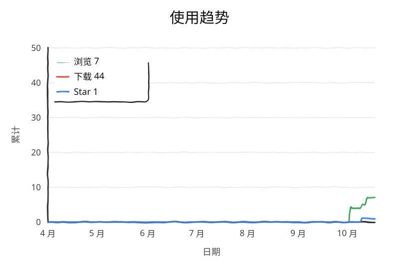

# 稿定工具箱

在稿定设计页面上，想保存一张预览图，往往得翻 DevTools 找请求。这个小脚本就是干这个的：
页面右下角多一个低调的「保存图片」，点一下就存，右键点它还能拿到原图地址。

在线页面能用，浏览器保存下来的本地 html 也能用。

## 它怎么找图

不是瞎抓，按优先级来：

1. 先拦住页面自己的 `risk_materials` 请求，把原生下载产物截下来
2. 原生下载有多个格式时，按 **PDF > PSD > PNG > JPG/JPEG > WEBP > AVIF** 的顺序取最好的
3. 没截到原生下载，就退回当前可见画布
4. 画布也拿不到，最后用 `window.__SSR_TEMPLATE.preview.url`

## 怎么用

用 Tampermonkey 装上 `gaoding-toolkit.user.js`。

- **在线页面**：打开稿定设计页，右下角出现「保存图片」。左键存图，右键复制原图地址。
- **本地保存的页面**：需要在 Tampermonkey 里给这个脚本打开 `file://` 页面访问权限，然后正常打开 html 就行。

## 可能遇到的情况

- 不同页面结构、渲染状态、下载链路都不一样，最终能存到什么，取决于页面当时实际给得出来的东西
- 页面本身就没有可用预览图或导出结果时，按钮会显示无法保存
- 更适合当个人辅助工具用，不适合批量抓取

## 免责声明

本项目仅供学习、交流与前端页面研究使用。使用前请自行确认目标平台的服务规则、版权要求和账号风险。
因使用本项目导致的限制、异常或其他后果，由使用者自行承担。

## 访问量

<picture>
  <source media="(prefers-color-scheme: dark)" srcset="traffic/views-dark.svg" />
  <source media="(prefers-color-scheme: light)" srcset="traffic/views.svg" />
  
</picture>
